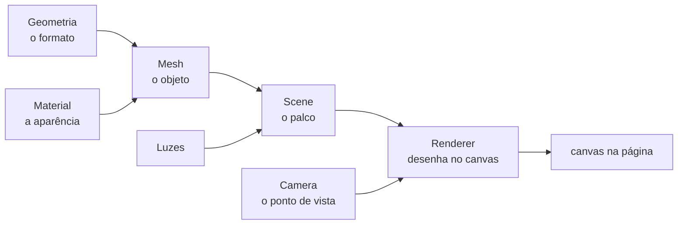
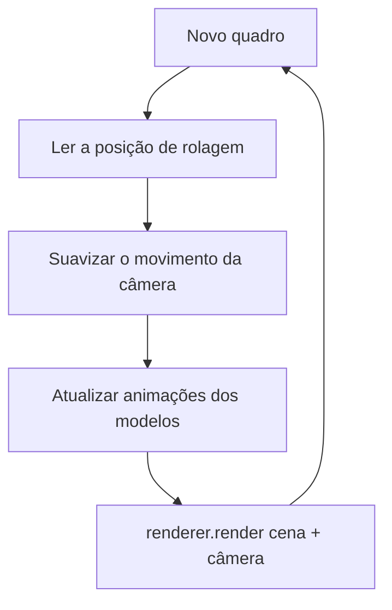

# LR Mídias

Site institucional da **LR Mídias**, agência de marketing digital. É uma página única e minimalista com uma **cena 3D que acompanha a rolagem**: cada seção tem seu próprio modelo 3D e a câmera desce junto com quem navega.

> Direção criativa que movimenta seu negócio, onde ele estiver.

---

## Sumário

1. [O que tem no site](#o-que-tem-no-site)
2. [Tecnologias](#tecnologias)
3. [Como o 3D funciona na web](#como-o-3d-funciona-na-web)
4. [Como o 3D funciona neste site](#como-o-3d-funciona-neste-site)
5. [Rolagem dinâmica e animações](#rolagem-dinâmica-e-animações)
6. [Tema claro e escuro](#tema-claro-e-escuro)
7. [Responsividade](#responsividade)
8. [Desempenho](#desempenho)
9. [Acessibilidade e plano B](#acessibilidade-e-plano-b)
10. [Estrutura do projeto](#estrutura-do-projeto)
11. [Como rodar e publicar](#como-rodar-e-publicar)
12. [Como personalizar](#como-personalizar)
13. [Problemas comuns](#problemas-comuns)
14. [Pendências](#pendências)
15. [Glossário](#glossário)

---

## O que tem no site

| Seção | Conteúdo |
| --- | --- |
| Início | Nome, slogan e botões de contato |
| Sobre | Quem é a LR e como trabalha |
| Serviços | Os 10 serviços da agência |
| Resultados | Caso Assados do Nando, com números do 1º ao 4º mês |
| Portfólio | 20 perfis de clientes, cada um levando ao Instagram |
| Clientes | Seção "O que os nossos clientes estão dizendo", com os feedbacks |
| Localização | Mapa ilustrado e botões "Como chegar" e "Ver no mapa" (Google Maps) |
| Contato | WhatsApp, e-mail (com botão de copiar) e Instagram |

Também há um botão de WhatsApp fixo na tela, um indicador da seção atual (por exemplo, `03 / 08 · Serviços`) e uma barra de progresso de leitura no topo.

---

## Tecnologias

| Tecnologia | Para que serve aqui |
| --- | --- |
| **HTML5** | Estrutura semântica da página (`header`, `main`, `section`, `footer`) |
| **CSS3** | Layout, tema claro e escuro, animações, painéis de vidro e responsividade |
| **JavaScript (ES5, sem build)** | Rolagem, animações de entrada, inclinação dos cartões e a cena 3D |
| **Three.js r128** | Biblioteca que desenha o 3D por cima do WebGL |
| **WebGL** | API do navegador que usa a placa de vídeo para desenhar gráficos |
| **Google Fonts** | Fraunces (títulos) e Hanken Grotesk (textos) |
| **Google Maps (link)** | Os botões de rota abrem o Google Maps |

Decisões de projeto:

- **Sem build e sem dependências locais.** Não há `npm`, bundler nem framework. É um único `index.html` com CSS e JavaScript dentro. Isso deixa o projeto fácil de abrir, editar e publicar.
- **Three.js por CDN.** Carregado de `cdnjs.cloudflare.com` com a versão fixa `r128`, para o site não mudar de comportamento sozinho.
- **JavaScript em ES5.** Funciona em navegadores antigos sem precisar de transpilação.

---

## Como o 3D funciona na web

### 1. Do navegador à placa de vídeo

Páginas web normalmente são desenhadas pelo processador, como texto e caixas. Para 3D, o navegador oferece o **WebGL**: uma API que permite mandar para a **GPU** (placa de vídeo) listas de pontos no espaço e pequenos programas (*shaders*) que dizem como pintar cada pixel. A GPU faz milhões desses cálculos em paralelo, o que torna possível redesenhar a cena 60 vezes por segundo.

O WebGL é de baixo nível: desenhar um simples cubo exige dezenas de linhas de código. Por isso usamos o **Three.js**, que esconde essa complexidade e entrega peças prontas.

### 2. As peças de uma cena Three.js



| Peça | O que é | Exemplo neste site |
| --- | --- | --- |
| **Scene** | O "palco" onde tudo é colocado | Uma cena com todos os modelos empilhados na vertical |
| **Geometry** | O formato (vértices e faces) | `IcosahedronGeometry`, `TorusGeometry`, `BoxGeometry`, `SphereGeometry`, `TorusKnotGeometry` |
| **Material** | A aparência: cor, brilho, transparência | `MeshStandardMaterial` (reage à luz) e `MeshBasicMaterial` (cor chapada, usada em aramados) |
| **Mesh** | Geometria + material = objeto visível | O núcleo dourado do início, os blocos de serviços |
| **Group** | Agrupa vários meshes para mover juntos | Cada seção é um `Group` com seu modelo |
| **Light** | Luzes (sem elas, materiais padrão ficam pretos) | Uma `AmbientLight` e uma `DirectionalLight`, ambas com intensidade 0,62 |
| **Camera** | De onde olhamos | `PerspectiveCamera` com 42° de campo de visão |
| **Renderer** | Pega cena e câmera e desenha no `<canvas>` | `WebGLRenderer` com fundo transparente |

### 3. O laço de renderização

Uma imagem 3D parada é só uma foto. Para ter movimento, o navegador chama uma função a cada quadro, usando `requestAnimationFrame`:



Em cada volta, o site lê a rolagem, move a câmera, atualiza os modelos visíveis e manda o Three.js desenhar. O `requestAnimationFrame` sincroniza com a taxa de atualização da tela e pausa sozinho quando a aba fica em segundo plano.

### 4. Perspectiva e profundidade

A `PerspectiveCamera` imita o olho humano: objetos mais distantes parecem menores. Os parâmetros são:

- **FOV (42°)**: abertura vertical da visão. Valores menores dão aparência mais "achatada", maiores dão mais distorção.
- **Aspect**: largura dividida pela altura da tela. É recalculado a cada redimensionamento.
- **Near e far (0,1 e 100)**: o que estiver mais perto ou mais longe que isso não é desenhado.

---

## Como o 3D funciona neste site

### O canvas fica atrás de tudo

O `<canvas id="scene">` é fixo na tela (`position: fixed`), ocupa a janela inteira, fica atrás do conteúdo (`z-index: 0`) e ignora cliques (`pointer-events: none`). O texto e os botões ficam por cima (`z-index: 1`) e continuam clicáveis. O renderer usa fundo transparente (`alpha: true`), então a cor de fundo da página aparece por trás dos modelos.

### Uma "estação" por seção

A cena é uma torre vertical. Cada seção da página tem um modelo 3D próprio, e os modelos são empilhados com **6 unidades** de distância entre si (constante `STEP`):

| Seção | Modelo |
| --- | --- |
| Início | Casca aramada com núcleo dourado e anéis |
| Sobre | Esfera central com órbita de pequenas esferas |
| Serviços | Painéis em forma de azulejos |
| Resultados | Barras 3D com esferas no topo (o "antes e depois") |
| Portfólio | Grade de colunas |
| Clientes | Casca com esferas flutuando |
| Localização | Grade de terreno com um pino que salta e ondas |
| Contato | Nó toroidal com halo |

Além disso, há **300 partículas** espalhadas na altura toda, que dão sensação de profundidade.

### A câmera acompanha a rolagem

Em vez de mover os modelos, o site move a **câmera**. A lógica:

1. `sectionPos()` calcula uma **posição fracionária** na página: `0` é o início, `1` é a seção Sobre, `7` é o Contato, e valores intermediários como `2,4` significam "40% do caminho entre Serviços e Resultados". Ela usa o centro da tela e o centro de cada seção, então funciona mesmo com seções de alturas diferentes.
2. A posição da câmera no eixo Y é `-posição × STEP`. Ou seja, rolar a página desce a câmera pela torre de modelos.
3. O valor não é aplicado direto: ele é **suavizado** com um decaimento exponencial (`sCur += (alvo - sCur) × (1 - e^(-dt × 5))`). Por isso a câmera desliza em vez de pular, e o efeito não depende da taxa de quadros do aparelho.
4. O mouse adiciona um **paralaxe** leve: a câmera se desloca um pouco para o lado em que o cursor está (desativado em telas de toque).
5. A velocidade da rolagem acelera as animações dos modelos. Quanto mais rápido você rola, mais rápido eles giram.

### Só o que está perto é desenhado

Cada modelo só fica visível (`group.visible`) quando a câmera está a menos de 1,7 estação dele. Os outros são ignorados pelo renderer. Um modelo também ganha um pequeno efeito de escala quando está em foco (de 85% a 100%).

### Posicionamento conforme a tela

- **Telas largas** (largura de pelo menos 861px e proporção maior que 1,1): o modelo é deslocado para a metade direita da tela, deixando o texto à esquerda.
- **Telas estreitas** (celular e tablet em pé): o modelo fica centralizado e é reduzido conforme a largura, e o canvas fica mais transparente (50% abaixo de 860px, 38% abaixo de 560px) para não competir com o texto.

---

## Rolagem dinâmica e animações

| Efeito | Como é feito |
| --- | --- |
| **Barra de progresso** | Um elemento fixo com `transform: scaleX()` ligado à rolagem |
| **Indicador de seção** | O mesmo `sectionPos()` da câmera, arredondado, atualiza o texto `03 / 08 · Serviços` |
| **Título do início** | Desloca levemente para baixo conforme a rolagem (efeito de paralaxe) |
| **Entrada dos itens** | `IntersectionObserver` observa os blocos abaixo da tela; ao entrarem, ganham a classe `in` e sobem 30px com fade. Itens que já estão visíveis no carregamento não são escondidos |
| **Inclinação nos depoimentos** | `pointermove` calcula a posição do mouse dentro do cartão e grava as variáveis CSS `--rx` e `--ry`, usadas em `perspective()` + `rotateX/Y` |
| **Hover nos botões e links** | Transições CSS (`transform`, cor, sombra), ativas só em dispositivos com mouse (`@media (hover: hover)`) |
| **Toque** | Só o efeito de "afundar" ao tocar; os efeitos de hover não ficam presos no celular |

Todo o movimento de rolagem roda dentro de `requestAnimationFrame`, para não recalcular mais de uma vez por quadro.

---

## Tema claro e escuro

As cores ficam em **variáveis CSS** (`--bg`, `--fg`, `--accent`, `--hi`, `--muted`, `--line` e as versões invertidas). O tema é escolhido por `prefers-color-scheme` e também aceita `data-theme="light"` ou `"dark"` no elemento `<html>`.

O 3D usa as **mesmas variáveis**: ao criar a cena e a cada mudança de tema, o JavaScript lê os valores com `getComputedStyle` e atualiza as cores dos materiais. Assim, modelo e página nunca ficam fora de sintonia, e basta mudar a paleta no CSS para a cena inteira acompanhar.

---

## Responsividade

- **Gutter lateral de 16px ou mais** em todas as larguras, respeitando as áreas seguras de celulares com notch (`env(safe-area-inset-*)`).
- **Grades que empilham**: duas colunas viram uma abaixo de 860px.
- **Menu rolável** em uma linha no celular.
- **Botões em largura total** e com altura mínima de 44px para o toque.
- **Sem rolagem horizontal** em nenhuma largura (testado em 390px e 1440px).
- A meta `viewport` com `viewport-fit=cover` é o que faz o celular usar a largura real da tela.

### Painéis de vidro

Para o texto continuar legível sobre os modelos 3D, blocos de conteúdo recebem fundo semitransparente com desfoque (`background: color-mix(...)` + `backdrop-filter: blur()`). Navegadores sem suporte a `color-mix` usam a cor sólida, escrita logo antes como alternativa.

---

## Desempenho

- **Resolução limitada**: `setPixelRatio(min(devicePixelRatio, 2))`. Telas com densidade 3x não renderizam 9 pixels por pixel de CSS.
- **Culling manual**: só os modelos próximos à câmera são desenhados.
- **Geometrias leves**: poucos polígonos por modelo, com sombreamento chapado onde possível.
- **Uma única `scene` e um único `canvas`**, sem pós-processamento.
- **Eventos de rolagem passivos** (`{ passive: true }`) e atualizados no máximo uma vez por quadro.
- **Pausa automática** em aba oculta, pelo próprio `requestAnimationFrame`.

---

## Acessibilidade e plano B

- **`prefers-reduced-motion`**: quem pede menos movimento no aparelho não vê animações de entrada, de hover nem o giro contínuo dos modelos. A cena é desenhada de forma estática e só se atualiza ao rolar.
- **Sem WebGL**: se o navegador ou o aparelho não suportar, o `try/catch` ao criar o renderer adiciona a classe `no-3d` ao `<body>`, o canvas some e o site continua completo.
- **`aria-hidden`** no canvas, na barra de progresso e no indicador: são decorativos e não poluem leitores de tela.
- **Foco visível** nos links e botões, para navegação por teclado.
- **Texto sempre legível**: o conteúdo está no HTML, não dentro do 3D.
- O conteúdo não depende de JavaScript para existir; o JavaScript só adiciona o movimento.

---

## Estrutura do projeto

```
.
├── index.html   # a página inteira: HTML, CSS e JavaScript
└── README.md    # este arquivo
```

Dentro do `index.html`:

| Bloco | O que contém |
| --- | --- |
| `<style>` | Tokens de cor, tipografia, layout, tema, animações e responsividade |
| `<canvas id="scene">` | A cena 3D |
| `<header>`, `<main>`, `<footer>` | Conteúdo das seções |
| Script de Three.js | Carrega o `three.min.js` (r128) |
| Script principal | Rolagem, animações de entrada, inclinação, HUD e cena 3D |
| Script do e-mail | Botão "Copiar e-mail" |

---

## Como rodar e publicar

### Local

Basta abrir o `index.html` no navegador. É preciso estar online para carregar o Three.js e as fontes. Se preferir um servidor local:

```bash
python3 -m http.server 8000
# abra http://localhost:8000
```

### GitHub Pages (grátis)

1. No repositório, vá em **Settings → Pages**.
2. Em **Build and deployment**, escolha **Deploy from a branch**.
3. Selecione a branch `main` e a pasta `/ (root)`.
4. Salve e aguarde um ou dois minutos. O endereço aparece na mesma tela.

---

## Como personalizar

**Trocar as cores.** Edite as variáveis no começo do `<style>` (`--accent`, `--hi`, `--bg`, `--fg`...), tanto no bloco claro quanto nos dois blocos escuros. O 3D acompanha automaticamente.

**Trocar o endereço do mapa.** Na seção `#localizacao`, altere o texto do endereço e os dois links do Google Maps (`destination=` e `query=`).

**Adicionar depoimentos.** Copie um bloco `<figure class="quote">` dentro de `.quotes`.

**Ajustar a distância entre os modelos.** Altere a constante `STEP` no script (padrão `6`). Valores maiores deixam a viagem da câmera mais longa.

**Mudar a intensidade do 3D no celular.** Procure `#scene { opacity: ... }` nas regras de `@media`.

**Criar um novo modelo.** Escreva uma função `buildNome()` que retorna um `THREE.Group` com `userData.update = function (t) { ... }` para animar, e adicione-a à lista `stages`. Depois, inclua o `id` da nova seção nas listas `ids` e `names` do script, para a câmera saber onde parar.

---

## Problemas comuns

| Sintoma | Causa provável | O que fazer |
| --- | --- | --- |
| Página sem o 3D | WebGL desativado ou sem internet para o CDN | Verifique a conexão e a aceleração por hardware do navegador. O site funciona sem o 3D |
| No celular a página aparece pequena | Falta da meta `viewport` | Mantenha a linha `<meta name="viewport" ...>` no `<head>` |
| Fontes diferentes das do projeto | O Google Fonts não carregou | O site usa fontes de reserva (serifa e sem serifa do sistema) |
| Cena pesada em aparelho antigo | GPU fraca | Reduza o `setPixelRatio` para 1 ou ative "reduzir movimento" |
| Acentos quebrados | Arquivo salvo fora de UTF-8 | Salve em UTF-8; o `<meta charset="utf-8">` já está presente |

---

## Pendências

- Trocar o destino do mapa pelo endereço completo da LR (hoje aponta para "Nova Friburgo, RJ").
- Colocar os links individuais dos depoimentos em vídeo (hoje o botão leva ao destaque do Instagram).
- Formulário de e-mail da bio: não foi incluído, pois a página estática não tem onde guardar os cadastros.

---

## Glossário

- **WebGL**: API do navegador para desenhar gráficos 2D e 3D usando a placa de vídeo.
- **GPU**: processador da placa de vídeo, especializado em cálculos em paralelo.
- **Three.js**: biblioteca JavaScript que simplifica o uso do WebGL.
- **Scene / Camera / Renderer**: palco, ponto de vista e "pintor" de uma cena 3D.
- **Mesh**: objeto 3D visível, formado por uma geometria e um material.
- **Shader**: pequeno programa que roda na GPU e define como pintar a imagem.
- **FOV**: campo de visão da câmera, em graus.
- **Culling**: deixar de desenhar o que não precisa aparecer.
- **Paralaxe**: sensação de profundidade criada quando camadas se movem em velocidades diferentes.
- **`requestAnimationFrame`**: função do navegador que agenda o próximo quadro de animação.
- **`IntersectionObserver`**: API que avisa quando um elemento entra ou sai da área visível.
- **CDN**: rede de servidores que entrega arquivos de bibliotecas de forma rápida.
